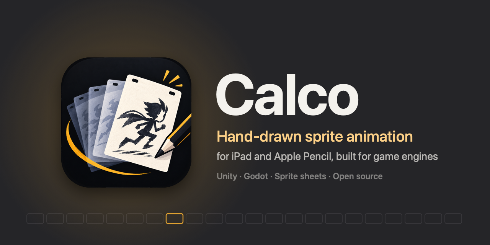

<p align="center"></p>

# Calco

**Hand-drawn sprite animation for iPad, built for game engines.**

Calco is an open source frame-by-frame animation app for iPad and Apple Pencil. Draw characters, props and backgrounds by hand, organize them into clips (idle, run, jump…), and export sprite sheets that drop straight into Unity.

Think *Procreate's Animation Assist* simplicity with the structure of a real animation tool, and an open project format you can read without the app.

> Status: **pre-alpha**. Nothing to download yet. Follow the repo to watch it grow.

📖 **User manual**, in English and Spanish: <https://rldona.github.io/Calco/> (source in [`manual/`](manual/)). Changes are in [CHANGELOG.md](CHANGELOG.md); how releases are built is in [docs/releasing.md](docs/releasing.md).

## Why

Today there is no hand-drawn (non pixel-art) sprite animation tool on iPad that speaks the language of game engines:

- Procreate exports loose PNGs with no metadata, and its frames are layers, so a frame can't have its own layers.
- RoughAnimator and Callipeg export video, not sprites.
- Aseprite is pixel-art only and desktop only.

Studios like Team Cherry draw frames by hand and assemble them in Unity manually. Calco wants to be that pipeline, on an iPad.

## Goals for v0.1

One goal: **draw a character with 2–3 clips and see it move in Unity.**

- Project = one character with N clips. Transparent canvas, size chosen at creation.
- Ink brush + eraser with pressure. Zoom/pan with two fingers. Undo/redo.
- Layers per frame (line, color, reference).
- Frame strip: add, duplicate, delete, reorder, hold per frame.
- Onion skin, before/after in different colors.
- Pivot per clip, dragged visually.
- Loop playback in the canvas.
- Export: sprite sheet PNG + JSON (Aseprite-compatible) and GIF.
- Open, documented `.calco` project format. See [docs/format.md](docs/format.md).
- Unity importer as a separate package ([`calco-unity/`](calco-unity/README.md)), reading the JSON into Sprites + AnimationClips + an AnimatorController.

Explicitly **out** of v0.1: audio, camera, tweening, vectors, custom brushes, text, pixel-art mode, iPhone, iCloud sync.

## Stack

- Swift / SwiftUI for the UI
- Metal for the canvas (PencilKit doesn't expose pixels or real layers)
- iPadOS 17+

## Building

The Xcode project is generated with [XcodeGen](https://github.com/yonaskolb/XcodeGen) so `.xcodeproj` noise stays out of git:

```sh
brew install xcodegen
xcodegen
open Calco.xcodeproj
```

To run it on your iPad you don't need the paid Apple Developer Program: in Xcode → **Settings** → **Accounts**, add your Apple ID; in the Calco target → **Signing & Capabilities**, pick your *Personal Team* (and change the bundle ID if it's taken); plug in the iPad and press **Run**. The first time, trust the developer on the iPad in **Settings** → **General** → **VPN & Device Management**. With a free account the app stops opening after 7 days: run it again from Xcode to renew it.

Or from a terminal, with the iPad plugged in (it builds an optimised Release, installs and opens Calco; run it again to renew the 7 days):

```sh
scripts/install-ipad.sh
```

It signs with the team in `project.yml`; to use yours, `DEVELOPMENT_TEAM=XXXXXXXXXX scripts/install-ipad.sh` (your Team ID is in Xcode → **Settings** → **Accounts**). With several devices plugged in, pass the iPad's UDID: `scripts/install-ipad.sh <UDID>`.

## Contributing

Early days. The best contribution right now is opinion: open an issue if you animate for games and something above looks wrong. Code contributions welcome once the canvas PoC lands.

## License

MIT. See [LICENSE](LICENSE).
